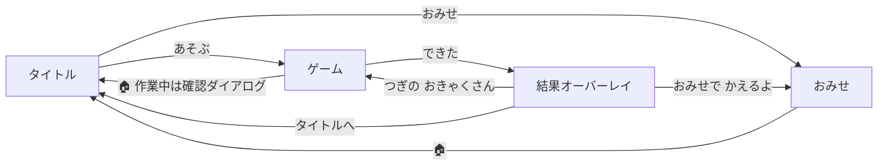

# ゆめいろヘアサロン 設計・実装概要

小学校低学年向けの美容室ごっこゲーム。スマートフォン・タブレットのブラウザで遊べる、HTML 1ファイル完結の作品。

| 項目 | 内容 |
|---|---|
| ファイル | `yumeiro-salon.html`（約800行 / 約56KB） |
| 対象 | 小学校低学年（ひらがな中心・音声読み上げあり） |
| 対応端末 | スマホ（縦・横）、タブレット（縦・横）、PC |
| 外部依存 | Google Fonts（Mochiy Pop One / M PLUS Rounded 1c）のみ。画像・音声ファイルなし |
| 技術 | HTML + CSS + 素のJavaScript（ライブラリ不使用）、インラインSVG、Web Audio API、Web Speech API、localStorage |

---

## 1. ゲーム概要

お客さんが来店し、「おねがい」カードに完成イメージ（絵）を出す。プレイヤーは7つのどうぐを使って髪型をおねがいと同じにし、「できた！」を押すと星とコインがもらえる。コインは「おみせ」で新しいかざり・髪の色・お客さんの購入に使う。

### 設計方針
- **字が読めなくても遊べる**：お題は文字ではなく絵で示し、音声でも読み上げる。
- **失敗させない**：星1つでも笑顔・拍手・紙ふぶきで褒める。時間制限なし。切りすぎても「のびーる」で戻せる。
- **触って気持ちいい**：泡、髪くず、キラキラ、効果音など、操作するたびに必ず反応を返す。
- **長く遊べる**：コイン → おみせ → お題の種類が増える、という循環を作る。

---

## 2. 画面構成と遷移



| 画面 | 要素 | 主な関数 |
|---|---|---|
| タイトル `#title` | ひさし（ストライプ）、跳ねる看板文字、1.5秒ごとに髪型が変わる鏡、あそぶ／おみせボタン、コイン・ランク表示、音・読み上げ切替 | `showTitle()` `titleTick()` |
| ゲーム `#game` | ヘッダー（🏠・コイン・何人目・切替）、おねがいカード＋できたボタン、鏡（電球つき）、オプションパネル、どうぐバー | `startGame()` `newCustomer()` |
| おみせ `#shop` | カテゴリ別のカード一覧、購入ボタン、トースト | `openShop()` `renderShop()` |
| 結果 `#result` | 星（1つずつ点灯）、おねがい／できあがりの比較絵、メッセージ、コイン加算、ランクアップ表示 | `finish()` |
| 確認 `#confirm` | 「タイトルに もどる？」 | — |

画面の切り替えは `showScreen(id)` に集約している。切り替え時には、オーバーレイを閉じ、タイトルのタイマーを止め、読み上げを中断する。

---

## 3. ゲームの流れ

1. **来店**：`newCustomer()` がお客さん・お題（target）・初期状態（cur）を作る。鏡にスライドイン演出を入れ、名前とおねがいを吹き出しと音声で伝える。
2. **施術**：7つのどうぐで `G.cur` を変更する。おねがいと一致した項目が増えるたびにチップに ✔ がつき、効果音と「いいね！」が出る。
3. **完成**：4項目すべてが一致すると「できた！」ボタンが脈打ち、「ぜんぶ おなじ！」と案内する。
4. **評価**：`finish()` で星とコインを計算・保存し、結果演出を出す。
5. **次へ**：「つぎの おきゃくさん」で手順1に戻る。

### どうぐ

| どうぐ | 操作 | 効果 |
|---|---|---|
| 🫧 あわあわ | 頭をこする | 泡を追加（最大70個、間隔16以上）。15個目で「きもちいい〜」 |
| 💨 ドライヤー | こする | 半径50以内の泡を消す。泡を20個以上出してから全部消すと「ぴかぴか」ボーナス |
| ✂️ はさみ | タップ | 長さ −1。髪くずのパーティクルが落ちる |
| 🪄 のびーる | タップ | 長さ +1。キラキラが出る |
| 🎨 いろ | パネルで選択 | 髪色を変更 |
| 💇 かたち | パネルで選択（ミニ絵つき） | スタイルを変更 |
| 🎀 かざり | パネルで選択 | アクセサリーを変更（「なし」も選べる） |

---

## 4. データモデル

### 髪型の状態（お題と現在の状態で共通）
```js
{ length: 0|1|2, color: 'brown'…, style: 'straight'…, acc: 'ribbon'… }
```

### マスタデータ

| 定数 | 内容 | 初期 | おみせ |
|---|---|---|---|
| `LENS` | みじかい／ふつう／ながい | 3 | — |
| `COLORS` | `{id, c(SVGのfill), css?, n, price?}` | 6色 | ぎんいろ30、にじいろ60 |
| `STYLES` | さらさら／くるくる／ツインテール／おだんご／ポニーテール | 5 | — |
| `ACCS` | `{id, e(絵文字), n, price?, verb?}` | リボン・かんむり・おはな・ほし（＋なし） | ハート20、さくらんぼ25、ぼうし35、めがね45 |
| `CUSTOMERS` | `{id, name, skin, ears?, earIn?, earOut?, patch?, price?}` | 7人 | コンちゃん40、メエちゃん40、パンパン55 |
| `TOOLS` | `{id, e, n, tip}` | 7 | — |
| `RANKS` | ランクと必要人数 | 0みならい／3スタイリスト／8にんきスタイリスト／15スーパースタイリスト／25カリスマびようし | — |

`price` があるものはショップ商品になる。`SHOP` 配列は起動時にマスタから自動生成する（キー形式は `acc:hat` `col:rainbow` `cust:panda`）。`availColors()` `availAccs()` `availCust()` は、未購入の商品を除いた一覧を返す。

### ゲーム状態 `G`
| キー | 意味 |
|---|---|
| `cust` / `target` / `cur` | 今のお客さん／お題／現在の髪型 |
| `matched` | 項目ごとの一致状態（新しく一致した瞬間の検出に使う） |
| `bubbles` / `maxB` / `pika` | 現在の泡／最大泡数／ぴかぴか達成 |
| `tool` / `face` | 選択中のどうぐ／表情（normal・wow・happy） |
| `acted` | 何か操作したか（何もせずに「できた」を押すのを防ぐ） |
| `busy` | 結果処理中（連打防止） |
| `hinted` | ドライヤー案内を出したか |

### 保存データ（localStorage）
キーは `yumeiro-salon-v1`。
```json
{ "coins": 0, "served": 0, "sound": true, "voice": true, "owned": ["acc:hat"] }
```
読み書きはすべて try/catch で囲んでおり、保存できない環境でも初期値で動く。

---

## 5. お題の生成ルール（`newCustomer`）

- お客さん：購入済みを含む一覧から選ぶ。前回と同じ人は避ける。
- お題：長さ・色・スタイル・かざりをランダムに選ぶ（かざりは「なし」以外）。
  - **例外**：おだんご × ぼうし／かんむり は、おだんごが隠れて絵で判断できないため除外する。
- 初期状態はお題と違う値から始める（長さ80%、色85%、スタイル80%の確率でずらす。かざりは常に「なし」）。そのため、来店時点で完成していることはない。

組み合わせ数（お客さんの違いは除く）：初期 約340通り、全商品購入後 約910通り。

---

## 6. 評価と報酬（`finish`）

| 一致数 | 星 | コイン |
|---|---|---|
| 4 | ⭐⭐⭐ | 30 |
| 2〜3 | ⭐⭐ | 20 |
| 0〜1 | ⭐ | 10 |

- ぴかぴか達成で +5 コイン。
- 1回あたり10〜35コインなので、ショップ商品（20〜60）は1〜3人ごとに1つ買える。
- 結果演出の順序：星を1つずつ点灯 → ファンファーレ・拍手・紙ふぶき・メッセージ読み上げ → コインのカウントアップとヘッダーへのコイン飛行 → ランクアップ表示。
- 演出のタイマーはすべて `later()` で `RT` 配列に登録し、`clearResultTimers()` でまとめて止める。演出中に画面を移っても、前の演出が残らない。

---

## 7. 描画（SVG）

キャラクターは `charSVG(state, {cust, face, pika, cape})` が返すSVG文字列で描く。鏡、おねがいカード、結果画面、ショップのプレビュー、タイトル、スタイル選択ボタンのすべてで同じ関数を使っており、どこでも見た目がそろう。

- 座標系は `viewBox="0 0 400 460"`、顔の中心は (200, 222)、半径90。
- 髪の長さは後ろ髪の下端 `B=[262,335,420]` と、テール長さ `L=[70,125,195]` で表す。

### 重ね順
1. ケープ・首
2. 動物の耳（`earsSVG`：cat / rabbit / bear / sheep）
3. 後ろ髪（スタイル別：さらさら＝パス、くるくる＝パス＋円の縁取り、ツイン／おだんご／ポニー＝短い後ろ髪＋パーツ）
4. ヘアゴム
5. 顔（`faceSVG`：パンダの目まわり、目、ほっぺ、口。表情は3種類）
6. 前髪（くるくるは円を追加）、おだんごのリボン、ツヤ
7. かざり（`accSVG`）
8. ぴかぴかの星（点滅）

### 特殊な色
にじいろとぎんいろは、`<body>` 先頭の非表示SVGにある `linearGradient`（`gRainbow` / `gSilver`、`userSpaceOnUse`）を `url(#id)` で参照する。CSSで使う場所（色ボタン、髪くず）には `css` プロパティのグラデーションを使う。

### まばたき
`.eyes` グループにCSSアニメーション（4秒周期）を当てている。

---

## 8. 入力処理

- タッチ判定は鏡のエリア全体 `.mwrap` で受ける（`touch-action:none`）。鏡の枠からこすり始めても反応する。
- Pointer Events と `setPointerCapture` を使い、指が外へはみ出しても追従する。
- 画面座標からSVG座標への変換は `getScreenCTM().inverse()` で行う。
- 判定領域：
  - 頭の楕円 `onHead`（中心 (200,195)、半径 138×128）：泡を出す範囲
  - キャラクターの範囲 `onChar`：はさみ・のびーるが効く範囲
- 指の位置に、選択中のどうぐの絵文字カーソルを表示する（指で隠れないよう左上にずらす）。
- 誤操作対策：
  - 何もしないで「できた」を押すと「まだ なにも してないよ〜」と返す。
  - 結果処理中（`busy`）は「できた」の連打を受け付けない。
  - 作業中に🏠を押すと確認ダイアログを出す。

---

## 9. サウンドと読み上げ

### 効果音（Web Audio API）
音声ファイルは使わず、オシレーターとノイズで合成している（`SFX`）。tap / pop / snip / sparkle / ding / boop / whoosh / coin / fanfare / color / star / clap の12種類。`AudioContext` は最初のボタン操作で作る（iOSの自動再生制限への対応）。

### 読み上げ（Web Speech API）
- `speak(text)` で読み上げる。日本語音声を自動で選び、話す速さは1.0、声の高さは1.25。読み上げ前に絵文字や記号を取り除く。
- 読み上げるタイミング：
  - 来店時のおねがい（`requestText`）
  - おねがいカードのタップ
  - どうぐの選択（名前と使い方）
  - 選択肢の名前
  - 褒め言葉
  - 結果メッセージ、ランクアップ
- 同時に複数読まないよう、毎回 `cancel()` してから読む。画面を移るときも止める。
- `speechSynthesis` がない環境では🗣️ボタンを隠す。

---

## 10. レイアウト（レスポンシブ）

| 条件 | レイアウト |
|---|---|
| 縦向き | ヘッダー／おねがい帯（横長）／鏡／パネル／どうぐ7列 |
| 横向き | 左：おねがい（縦長）＋鏡、右：パネル＋どうぐ4列 |
| 横向き・高さ540px以下（スマホ横） | 全体を圧縮。タイトルの鏡を左へ寄せ、結果を横並びにする |
| 幅360px以下 | おねがいチップを絵文字だけにする |

- 鏡のサイズはコンテナクエリ（`cqh` / `cqw`）で縦横比を保つ。非対応ブラウザ向けに `height:100%` のフォールバックを入れている。
- 選択肢が7個以上のときは、パネルを横スクロールにする（`.scroll`）。タブレットの横向きでは折り返して全部表示する。
- `viewport-fit=cover` とセーフエリア余白で、ノッチ付き端末に対応している。
- ダークモードでも配色トークンを切り替えて表示が崩れないようにしている。
- `prefers-reduced-motion` が有効な場合は、常時動くアニメーションを止める。

---

## 11. 演出（エフェクト）

`#fx` レイヤー（画面全体、`pointer-events:none`）にDOMパーティクルを出す。動きはCSS変数（`--dx --dy --rot --dur`）で指定し、終わったら自動で削除する。

| 関数 | 用途 |
|---|---|
| `sparkle(x,y,n,set)` | 放射状のキラキラ |
| `hairBits(x,y,bg)` | 落ちる髪くず |
| `confetti(n)` | 紙ふぶき |
| `claps(el)` | 拍手の絵文字 |
| `fx(...)` | 汎用（コインの飛行など） |

---

## 12. 拡張方法

| 追加したいもの | 手順 |
|---|---|
| かざり | `ACCS` に `{id, e, n, price?, verb?}` を追加し、`accSVG()` に描画の `case` を足す |
| 髪の色 | `COLORS` に追加する。グラデーションにする場合は `<defs>` に gradient を足し、`c:'url(#id)'` と `css` を指定する |
| お客さん | `CUSTOMERS` に追加する。新しい耳の形は `earsSVG()` に分岐を足す |
| 髪のかたち | `STYLES` に追加し、`charSVG()` の後ろ髪の分岐（長さ L / B を使う）に描画を足す |
| 商品化 | どれも `price` をつけるだけでショップに並び、購入後にお題にも出るようになる |
| ランク | `RANKS` に `[必要人数, 名前]` を追加する |

保存データの形式を変える場合は、localStorage のキーのバージョン（`-v1`）を上げるか、読み込み時に補完する（`owned` を補完している処理と同じやり方）。

---

## 13. テストと既知の制約

### 実施したテスト（ヘッドレスChromium）
- 画面サイズ：320×568、375×667、667×375、768×1024、1024×768
- 内容：タイトル → 6人連続で接客（泡 → ドライヤー → ぴかぴか → 全項目一致 → 星3つ） → おみせで購入（コイン不足時の拒否を含む） → 購入アイテムを使って接客
- 確認した点：
  - JavaScriptのエラーがないこと
  - 主要ボタンが画面内に収まること
  - 「できた」の二重押しで二重カウントされないこと
  - 何もしないで「できた」を押しても結果に進まないこと

### 既知の制約
- **iPhoneのマナーモード**：効果音は鳴らない（読み上げは端末によって聞こえる）。
