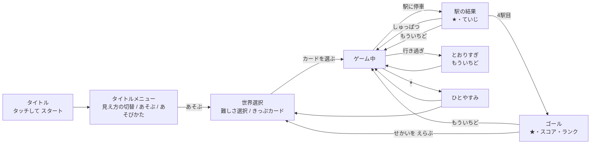

# ぴたっと ぽっぽごう 実装概要・設計書

対象ファイル：`pitatto-poppo.html`（単一ファイル構成）
対象年齢：6〜8歳（小学校低学年）
主な想定端末：タブレット・スマートフォン（タッチ操作、横向き）。PCのキーボード操作にも対応。

---

## 1. ゲーム概要

電車を運転して、駅のホームにある★マーク（停止位置）にぴったり止めるゲーム。止めた位置の正確さで★がもらえ、目標時間内に着けばボーナスが加わる。道中では、線路上の動物を汽笛でどかす、アイテムを集める、ゆっくりゾーンを速度を落として通過する、といった要素がある。

「駅に正確に止める」という遊びの仕組みだけを参考にしており、既存作品の名称・ロゴ・キャラクター・画面デザイン・音楽・効果音は一切使っていない。絵はすべてCanvasで描いた図形と端末の絵文字、音はすべてWeb Audio APIで合成した電子音でできている。

### 1.1 基本ルール

| 要素 | 内容 |
|---|---|
| 操作 | 「すすむ」長押しで加速、「とまる」長押しでブレーキ、「ポッポー」で汽笛 |
| 停止判定 | 速度ほぼ0の状態が0.45秒続き、★から手前8m〜奥20mの範囲にいれば判定する |
| 行き過ぎ | ★を20m超えると「とおりすぎちゃった！」となり、その区間をやり直す |
| ていじ | 区間ごとに目標時間を設定。間に合えば+50点、遅れると★が1つ減る |
| ゴール | 全4駅に停車するとゴール。★の合計でランク（S/A/B/C）が決まる |

---

## 2. 技術構成

| 項目 | 採用技術 |
|---|---|
| 構成 | HTML・CSS・JavaScriptをすべて1ファイルに収めている（外部JSライブラリなし） |
| 描画 | Canvas 2D（ゲーム画面）＋ HTML/CSS（UI、ボタン、モーダル） |
| 音 | Web Audio API（オシレーターとノイズで効果音とBGMをその場で合成） |
| フォント | Google Fonts「M PLUS Rounded 1c」。読めない場合は端末の丸ゴシックで代用 |
| 保存 | localStorage（キー：`pitatto-poppo-v1`） |
| 振動 | Vibration API（対応端末のみ。iOSは非対応のため何も起きない） |

外部への通信はフォント読み込みだけなので、オフラインでも遊べる（その場合は端末のフォントで表示される）。

---

## 3. 画面構成と遷移



画面が切り替わるときは、円が閉じて開くワイプ演出（約0.3秒×2）を挟む。ワイプ中は二重に操作を受け付けない。

### 3.1 フェーズ（`G.phase`）

| フェーズ | 意味 | 列車の挙動 |
|---|---|---|
| `run` | 通常走行 | プレイヤーの操作どおり |
| `station` | 停車して判定済み | 自動ブレーキ。動物が乗り込む演出 |
| `over` | 行き過ぎ | 自動で急ブレーキをかけ、止まってからお知らせを表示 |
| `paused` | 一時停止 | 更新停止、BGMも停止 |
| `clear` | ゴール画面 | 自動ブレーキ |

フェーズとは別に、`G.mode`（`demo`＝タイトル背景の自動走行 / `play`＝プレイ中）と `G.rot`（縦向きで止まっている状態）を持つ。

---

## 4. ゲームデータ（世界）

各世界は4駅で、区間の長さ・最高速度・登場キャラクターが異なる。

| # | 世界 | 最高速度 | 駅（区間長m） | アイテム | 障害物 |
|---|---|---|---|---|---|
| 1 | もりの でんしゃ | 60km/h | どんぐり380 / きのこ460 / もみじ480 / みずうみ520 | 🍎 | 🦌 |
| 2 | おかしの くに | 70km/h | クッキー420 / プリン500 / ドーナツ520 / ケーキじょう560 | 🍬 | 🐑 |
| 3 | うちゅう れっしゃ | 80km/h | おつきさま460 / どせい540 / ほうきぼし560 / ほしくず600 | ⭐ | 🛸 |
| 4 | にじいろ レール | 90km/h | わたぐも480 / にじのはし560 / ゆめ600 / おひさま640 | 💎 | 🐢 |

世界4は、全世界の★合計が20個以上で遊べるようになる。

### 4.1 区間内の配置ルール（区間長を L とする）

| オブジェクト | 位置 | 備考 |
|---|---|---|
| ゆっくりゾーン | 0.17L から45m | 制限30km/h。入って12m過ぎてから速度を判定する（入った瞬間に失敗にしないため） |
| 障害物（動物） | 0.42L＋0〜40m | 1区間に1匹 |
| トンネル | 0.62L から75m | 2区間目と4区間目のみ。うちゅうではワープトンネルになる |
| アイテム | 区間の始まり＋70mから等間隔に「3＋区間番号」グループ | 1グループ3〜5個。中央が大アイテムになることがある |
| 乗客 | 駅ごとに2・2・1・1人 | 合計6人（バックミラーと窓の数と同じ） |

トンネルと停車ホームが重ならないことは、区間長の最小値380mで確認済み。

---

## 5. 物理と判定

### 5.1 列車の運動（単位：m, m/s）

| 定数 | 値 | 説明 |
|---|---|---|
| `ACC` | 2.2 m/s² | 加速度。速度に応じて弱まる：`ACC × (1 − 0.55 × v / 最高速度)` |
| `BRAKE` | 3.4 m/s² | ブレーキの減速度 |
| `FRICTION` | 0.22 m/s² | どちらのボタンも押していないときの自然な減速 |

1フレームの経過時間は最大0.05秒に制限している（処理落ちしたときにワープしないため）。

### 5.2 停止位置の判定

★との距離 `d = 先頭位置 − 停止位置` の絶対値で判定する。

| 判定 | やさしい | ふつう | チャレンジ | ★ | 得点 |
|---|---|---|---|---|---|
| ぴったり！ | ±1.2m | ±1.0m | ±0.6m | 3 | 100 |
| すごい！ | ±3.5m | ±3.0m | ±2.0m | 2 | 60 |
| いいね！ | ±8m | ±7m | ±5m | 1 | 30 |
| おしい！ | それ以外（−8〜+20m） | | | 0 | 10 |

ていじのときは＋50点、遅れたときは★−1（0未満にはならない）。

### 5.3 ていじ（目標時間）の計算

区間ごとに「上手な運転」をシミュレーションした理想タイムを出し、難しさごとに余裕を足す。

```
目標時間 = 理想タイム × 倍率 + 加算秒
```

| 難しさ | 倍率 | 加算秒 | ヒント |
|---|---|---|---|
| やさしい | 1.5 | 45 | あり |
| ふつう | 1.3 | 35 | あり |
| チャレンジ | 1.15 | 15 | なし |

- 理想タイムは `idealTime()` で計算する。全力で加速し、ゆっくりゾーンでは30km/hを守り、最適な位置でブレーキをかけた場合の時間。
- 時間は列車が最初に動き出してから数える（出発の演出中は数えない）。
- 狙い：普通に運転すれば間に合い、極端にのろのろ進む「這い寄り」だけが遅刻になるようにする。テストでは、ふつうモードで普通に運転して13秒の余裕があった。

### 5.4 ランク

全駅の★合計（4駅で最大12）で決める。

| ランク | 条件（★合計） | 表示 |
|---|---|---|
| S | 11以上 | すごすぎ！ |
| A | 8以上 | じょうず！ |
| B | 5以上 | いいね！ |
| C | それ未満 | がんばった！ |

チャレンジモードでSを取ると、その世界のきっぷに👑がつく。

### 5.5 その他の得点

| 行動 | 得点 |
|---|---|
| アイテム | 10（大アイテムは30）＋（コンボ数−1）×5。1.5秒以内に続けて取るとコンボ |
| 汽笛で動物をどかす | +20（230m以内にいる動物が対象） |
| 動物を驚かせる（ぶつかる） | −10 |
| ゆっくりゾーンを守って通過 | +50 |

---

## 6. 描画設計

### 6.1 横から見るビュー（side）

- 縮尺：`ppm = max(8, min(W/46, H/10.5))`（1mあたりのピクセル数）。地面の高さは画面の64%（高さ460px未満なら58%）。
- 列車の先頭を画面の左から56%の位置に固定し、カメラが追いかける。
- 重ね順（奥から）：空 → 遠景の丘 → もや → 中景（木・お菓子・惑星）→ トンネルの奥側 → 地面と線路 → 駅の屋根・看板 → ゆっくりゾーン → 煙 → 列車 → 火花 → ホームの手前側 → 動物 → 乗客 → トンネルの手前側 → 手前の草花 → アイテム → スピード線 → 画面の縁の暗がり
- 遠景・中景は奥ほどゆっくり動く（視差スクロール）。オブジェクトの配置はハッシュ関数で決まるので、毎回同じ景色になる。

### 6.2 運転席ビュー（cab）

疑似3Dの透視投影で描く。

```
P(z, lx, h) = [ 画面中央X + lx × f/z,  地平線Y + (カメラ高さ − h) × f/z ]
f = min(W, 1.7H) × 0.8、カメラ高さ = 2.4m、地平線 = 画面の42%の高さ
```

- カメラは列車の先頭から10m後ろに置く。これで、正しく停車したとき★の標識が10m先に見える。
- 描くもの（景色・駅・標識・動物・アイテム・トンネル）を奥から手前の順に並べて描く。
- トンネルの中にいるときは、出口のアーチの形で奥の景色を切り抜き、壁の中に景色が透けないようにしている。
- 運転席らしさを出すため、窓枠・運転台・マスコット・バックミラー（乗客が映る）・ぴったりメーター（画面右に★までの距離を表示）を重ねて描く。

### 6.3 キャラクターの表情（`G.mood`）

| 表情 | きっかけ |
|---|---|
| happy（にっこり） | アイテムを取る、停車する、ゆっくりゾーン成功、ゴール |
| surprise（びっくり） | 最高速度の70%以上で急ブレーキ、動物にぶつかる |
| sweat（汗） | 行き過ぎ |
| normal（ふつう） | 上記以外。ときどきまばたきする |

運転席ビューでは、運転台のマスコットが跳ねて同じ気持ちを表す。

### 6.4 演出

円ワイプ、出発バナー（「しゅっぱつ しんこう！」）、紙吹雪、得点の数字が飛ぶ、スコアのカウントアップ、結果の★が1つずつ光る、ランクのハンコ、画面の揺れ、白いフラッシュ。動きを減らす設定（prefers-reduced-motion）が有効な端末では、揺れや繰り返しアニメを止める。

---

## 7. 音の設計

すべてWeb Audio APIでその場で合成しているため、音声ファイルは持っていない。

| 種類 | 内容 |
|---|---|
| BGM | 世界ごとに32ステップのオリジナルのメロディ、ベース、和音、キック、ハイハット。先読み方式で途切れないように鳴らす |
| 走行音 | 速度に合わせて音程が変わるエンジン音と、12.5mごとの「ガタンゴトン」 |
| 効果音 | 汽笛、アイテム（コンボで音が高くなる）、チャイム、ドアチャイム、★、ハンコ、ワイプ、ブレーキのきしみ、ゆっくりゾーンの警告と成功 |

ブラウザの決まりで、音は最初のタッチまたはキー操作のあとに鳴り始める（タイトルの「タッチして スタート」がそのきっかけを兼ねている）。一時停止中とタブが裏にあるときは止める。ミュートの設定は保存される。

---

## 8. 入力

| 操作 | タッチ | キーボード |
|---|---|---|
| 加速 | 「すすむ」長押し | → / D |
| ブレーキ | 「とまる」長押し | ← / A / ↓ |
| 汽笛 | 「ポッポー」 | スペース / H（プレイ中のみ） |
| 見え方の切替 | 🎥 | V |
| 一時停止 | ⏸ | Esc |
| スタート | 画面をタッチ | Enter / スペース |

- 長押しボタンは pointer events とポインターキャプチャで実装しているので、指がボタンから少しずれても押したままになる。
- 両方のボタンを同時に押したときはブレーキを優先する。
- 長押しで出るメニュー、文字の選択、ダブルタップでの拡大はすべて無効にしている。

---

## 9. 画面サイズへの対応

| 状況 | 対応 |
|---|---|
| 横向きのスマホ（高さ460px以下） | ボタン、メーター、文字を小さくし、地面の位置を上げる |
| 縦向きのスマホ（幅700px未満かつ縦長） | プレイ中は「よこに してね」と表示し、自動で一時停止する。横にすると再開する |
| iPadの縦向き | そのまま遊べる（見える前方は少し狭くなる） |
| ノッチのある端末 | safe-area の余白で、UIがノッチや角に重ならないようにする |
| ダークモード | パネルの色をダーク用に切り替える（ゲーム画面は世界の色のまま） |

---

## 10. 保存データ

localStorage のキー `pitatto-poppo-v1` に JSON で保存する。

```json
{
  "best":  { "forest": 11 },
  "hi":    { "forest": 720 },
  "grade": { "forest": "S" },
  "crown": { "forest": true },
  "muted": false,
  "view":  "side",
  "mode":  "normal"
}
```

- 読み込み時は既定値に上書きして合成するので、古い版の保存データでも動く（確認済み）。
- 読み書きはすべて try/catch で囲んでいる。保存できない環境でも遊ぶことはできる。

---

## 11. パフォーマンス対策

| 対策 | 内容 |
|---|---|
| 絵文字キャッシュ | 絵文字を4段階の大きさ（48/128/288/512px）で一度だけ画像化し、拡大縮小して使い回す |
| 解像度の上限 | 実際に描くピクセル数が約230万を超えないように、端末のピクセル倍率（DPR）を下げる |
| 経過時間の上限 | 1フレームの経過時間を0.05秒までにして、重いときもワープしないようにする |
| 表示更新の差分化 | HUDの文字は、値が変わったときだけ書き換える |
| 画面外を描かない | 画面の外にあるオブジェクトは描画を省く |

GPUのないテスト環境での比較では、運転席ビューが18fpsから37fpsへ、横ビューが21fpsから31fpsへ改善した。実際の端末ではこれより速く動く。

---

## 12. 主要な関数

| 関数 | 役割 |
|---|---|
| `startWorld(w)` | 世界を始める（駅・アイテム・障害物・トンネル・ゾーン・目標時間を作る） |
| `update(dt)` | 毎フレームの更新（運動、取得、障害物、ゾーン、停車判定、乗り込み） |
| `judge(d)` | 停車の判定（★・ていじ・得点・演出） |
| `proceed()` / `retry()` | 次の区間へ進む / 区間をやり直す |
| `finish()` | ゴールの演出（★ → スコア → ハンコの順に段階表示）と保存 |
| `render()` / `renderCab()` | 横ビュー / 運転席ビューの描画 |
| `idealTime()` | 目標時間の計算に使う理想タイムのシミュレーション |
| `wipe(fn)` / `banner(t1,t2)` | 画面切り替えのワイプ / 出発バナー |
| `checkRotate()` | 縦向きを検出して一時停止する |
| `emoji(e,x,y,size)` | キャッシュした絵文字を描く |

---

## 13. テスト結果（最終版）

ヘッドレスブラウザ（Playwright）で、次の項目を確認した。

- 4駅を通してゴールし、保存して世界選択に戻れる（チャレンジモード、うちゅう れっしゃで確認）
- 行き過ぎからのやり直し、遅刻による★−1、Sランクと👑
- 駅の手前で止まっても判定されず、そのまま進み直せる
- カードを素早く続けて押しても二重に始まらない／ボタンを押した直後のスペースキーで誤作動しない
- タブを切り替えると自動で一時停止する／結果画面の途中で縦向きにしても続きから遊べる
- 古い保存データを読み込める（★20個で世界4が遊べるようになる）
- iPhone SEの横向き、iPadの縦向き、フルHDで表示が崩れない
- エラーなし

検証しきれていない点：極端にのろのろ進むと遅刻になることは、テストの実行時間の都合で最後まで通していない（計算上は、ふつうの制限時間約80秒に対し、最後の120mを這うだけで100秒以上かかる）。

---

## 14. 既知の制約

- **絵文字の見た目が端末で変わる**：動物・木・乗客などは端末の絵文字フォントで描いている。揃えるには自作の絵に置き換える必要がある。Web用の絵文字フォントを読み込む方法は、iPadで表示されなくなる恐れがあるため採用していない。
- **iOSでは振動しない**：Vibration APIにiOSが対応していないため。
- **保存はブラウザごと**：別の端末や別のブラウザとは記録が共有されない。
- **チャレンジモードのヒント**：駅の手前で止まっても案内は出ない（意図した仕様）。

---

## 15. 拡張のしかた

| やりたいこと | 変更する場所 |
|---|---|
| 世界を追加する | `WORLDS` 配列に1件足す（色、駅、乗客、アイテム、BGMのメロディ）。運転席ビュー用の景色は `SCN`、マスコットは `MASCOT` に追加する |
| 駅を増やす | 世界の `stations` と `sEmoji` を増やし、駅ごとの乗客数 `PAXN` を調整する（窓とミラーは6人分） |
| 難しさを調整する | `MODES`（倍率・加算秒・判定の許容幅・ヒント）と、物理定数の `ACC` / `BRAKE` |
| 得点を調整する | `judge()`、アイテム取得の処理、ゾーン判定の処理 |
| 遊べるようになる条件を変える | 世界の `unlock` の値 |
